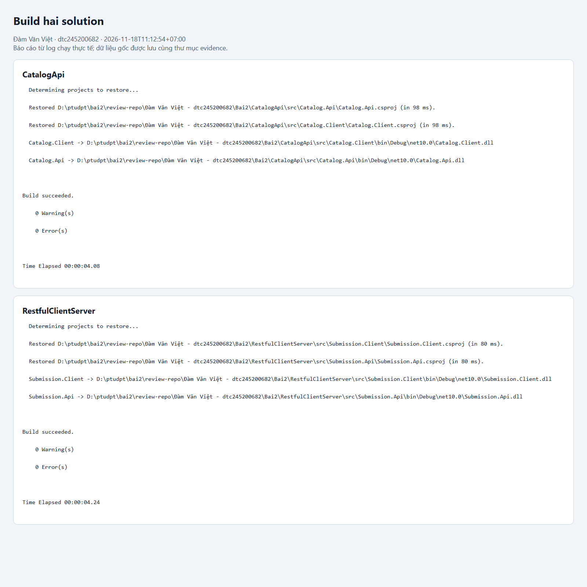
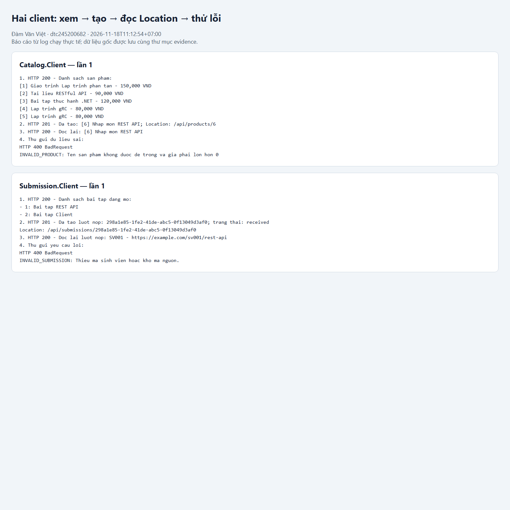
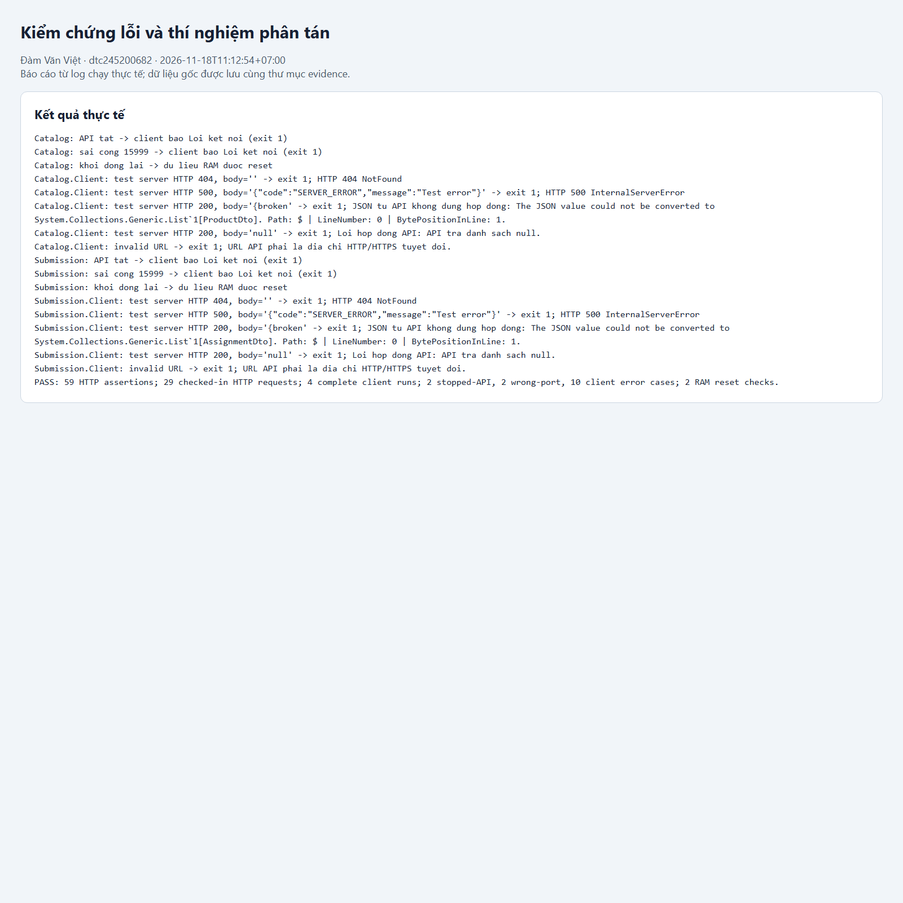

# Bài 2 – RESTful API: Catalog và EduSubmit

| Thông tin | Giá trị |
|---|---|
| Sinh viên / MSSV | **Đàm Văn Việt / dtc245200682** |
| Lớp | CNTT K23E – Phát triển ứng dụng phân tán |
| GitHub / email Git | Viet0810 / dtc245200682@ictu.edu.vn |
| Nhánh nộp | `bai2-dtc245200682` |
| Thư mục | `Đàm Văn Việt - dtc245200682/Bai2/` |
| PR ban đầu | [PTUDPTK23/CNTTK23E#4](https://github.com/PTUDPTK23/CNTTK23E/pull/4) |

Căn cứ `Bai2_RESTful-API_Send.pdf`: Catalog (bước 6–10, trang 54–63), EduSubmit (trang 64–90), yêu cầu nộp trang 90 và thông báo ngày 17/11 trong [README repo lớp](https://github.com/PTUDPTK23/CNTTK23E#readme). Bổ sung ngày **18/11/2026**: minh chứng chạy, bốn bước client, xử lý lỗi, nhật ký và [đối chiếu tiêu chí chấm](DOI-CHIEU-TIEU-CHI.md).

## 1. Cấu trúc và điều kiện chạy

```text
Bai2/
├── README.md
├── DOI-CHIEU-TIEU-CHI.md
├── requests.http                 # 7 ca EduSubmit cơ bản
├── CatalogApi/                   # API + console client, 8 ca HTTP
│   ├── CatalogApi.slnx
│   └── src/{Catalog.Api,Catalog.Client}/
├── RestfulClientServer/           # EduSubmit, 14 ca HTTP đầy đủ
│   ├── RestfulClientServer.slnx
│   └── src/{Submission.Api,Submission.Client}/
├── verify-api.py
├── verification-results.txt
├── create-evidence.py
└── evidence/                     # Log gốc, JSON phản hồi, HTML và ảnh
```

- **.NET 10 SDK**, kiểm tra bằng `dotnet --version`. Hai solution dùng `.slnx`, bốn project target `net10.0`.
- VS Code + extension **REST Client** để gửi `.http`, hoặc `curl.exe` trên PowerShell.
- **Python 3** chỉ cần khi kiểm chứng tự động; dùng thư viện chuẩn, không cần cài package.
- Không cần database, đăng nhập hay package NuGet bổ sung. Dữ liệu lưu trong `List` trong RAM.
- Cổng mặc định: **5000** EduSubmit, **5100** Catalog. Kiểm chứng dùng riêng **15000, 15100**; cổng **15999** phải trống để thử địa chỉ sai.
- Môi trường đã chạy: Windows, SDK **10.0.403**, Python **3.13.15**.

Từ gốc repository vừa clone:

```powershell
cd "Đàm Văn Việt - dtc245200682/Bai2"
dotnet build CatalogApi/CatalogApi.slnx
dotnet build RestfulClientServer/RestfulClientServer.slnx
```

**Hai solution đã build thành công, mỗi solution 0 Warning(s), 0 Error(s).** Các lệnh tiếp theo chạy từ thư mục `Bai2/`, không phụ thuộc đường dẫn ổ đĩa riêng.

## 2. Chạy máy chủ và máy khách EduSubmit

Terminal 1 – máy chủ, giữ chạy:

```powershell
dotnet run --project RestfulClientServer/src/Submission.Api --no-launch-profile --urls http://localhost:5000
```

Terminal 2 – máy khách:

```powershell
dotnet run --project RestfulClientServer/src/Submission.Client -- http://localhost:5000
```

Client chạy **bốn bước**:

1. GET danh sách bài: **200**, in bài đang mở, chọn bài mở đầu tiên.
2. POST lượt nộp với mã `SV001` và URL minh họa: **201**, in GUID, `received` và `Location`.
3. GET đúng URL trong `Location`: **200**, kiểm tra DTO đọc lại bằng DTO vừa tạo, in mã SV và link repo.
4. POST hai trường rỗng: **400**, in `INVALID_SUBMISSION` cùng thông điệp. Đây là lỗi dự kiến của kịch bản; client kết thúc bình thường.

Dấu `--` chuyển URL vào `args[0]`; hai tiến trình dùng HTTP/JSON và không tham chiếu project nhau. Bài 1 và 2 mở, bài 3 đóng để thử quy tắc nghiệp vụ.

## 3. Chạy Catalog

Terminal 1:

```powershell
dotnet run --project CatalogApi/src/Catalog.Api --no-launch-profile --urls http://localhost:5100
```

Terminal 2:

```powershell
dotnet run --project CatalogApi/src/Catalog.Client -- http://localhost:5100
```

Bốn bước: **GET danh sách 200 → POST sản phẩm 201 + Location → GET Location 200 → POST sai 400 INVALID_PRODUCT**. API ban đầu có ba sản phẩm. Những POST kiểm thử chạy trước client làm danh sách trong ảnh minh chứng tăng lên.

## 4. Hợp đồng API và giao thức

| Method | URI EduSubmit | Thành công | Lỗi nghiệp vụ |
|---|---|---|---|
| GET | `/api/assignments` | 200 + mảng AssignmentDto | — |
| GET | `/api/assignments/{assignmentId:int}` | 200 + AssignmentDto | 404 ASSIGNMENT_NOT_FOUND |
| POST | `/api/assignments/{assignmentId:int}/submissions` | 201 + SubmissionDto + Location | 404 ASSIGNMENT_NOT_FOUND; 400 ASSIGNMENT_CLOSED / INVALID_SUBMISSION |
| GET | `/api/submissions/{submissionId:guid}` | 200 + SubmissionDto | 404 SUBMISSION_NOT_FOUND |

Có `GET /` trả 200 để kiểm tra dịch vụ. Catalog có `GET /`, `GET /api/products`, `GET /api/products/{id:int}`, `POST /api/products`; lỗi `PRODUCT_NOT_FOUND` và `INVALID_PRODUCT`. Tên sản phẩm không được trắng, giá phải lớn hơn 0.

POST EduSubmit dùng `Content-Type: application/json`:

```json
{"studentCode":"dtc245200682","repositoryUrl":"https://github.com/Viet0810/CNTTK23E"}
```

Thứ tự kiểm tra: **bài tồn tại → bài còn mở → đủ mã SV và link repo**. Trường thiếu/null/chuỗi trắng bị từ chối. Server Trim dữ liệu, sinh GUID, lấy AssignmentId từ route, tự điền `Status = received`, `ReceivedAt = DateTimeOffset.UtcNow`. DTO đầu vào không chứa Id/trạng thái/thời gian, nên client không tự quyết định những trường đó.

Lỗi nghiệp vụ cùng dạng `{ "code": "...", "message": "..." }`. Client kiểm tra HTTP status trước khi đọc DTO. Lỗi framework có thể không có ApiError; nhánh in lỗi hỗ trợ body rỗng/body thô. Lỗi mạng không có HTTP response được bắt riêng, exit 1. Client cũng báo lỗi có kiểm soát khi URL sai, JSON trả về hỏng/null hoặc DTO đọc lại không khớp. Timeout là 10 giây; chưa mô phỏng riêng ca timeout trong bộ kiểm chứng.

Thiết kế theo năm câu hỏi: (1) tài nguyên là bài tập/lượt nộp; (2) GET để xem, POST để tạo tài nguyên con; (3) đầu vào là mã SV/link repo, trường quản lý do server điền; (4) lỗi tài nguyên, trạng thái, dữ liệu, HTTP và mạng; (5) trình tự xem bài → nộp → đọc Location → thử lỗi.

## 5. requests.http và curl

Mở [requests.http](requests.http) tại gốc bài bằng REST Client. Gửi request 4 `createSubmission` trước request 5 để biến `{{createSubmission.response.body.$.id}}` lấy GUID mới. Sau khi API khởi động lại cần tạo lượt nộp mới.

| Ca | Request | Mong đợi | Thực tế 18/11 |
|---|---|---|---|
| 1 | GET danh sách bài | 200 + mảng | 200, đạt |
| 2 | GET bài 1 | 200, id = 1 | 200, đạt |
| 3 | GET bài 999 | 404 ASSIGNMENT_NOT_FOUND | 404, đạt |
| 4 | POST hợp lệ | 201 + GUID + received + Location | 201, đạt |
| 5 | GET lượt nộp vừa tạo | 200, cùng dữ liệu | 200, đạt |
| 6 | POST trường rỗng | 400 INVALID_SUBMISSION | 400, đạt |
| 7 | GET GUID không tồn tại | 404 SUBMISSION_NOT_FOUND | 404, đạt |

[RestfulClientServer/requests.http](RestfulClientServer/requests.http) có **14 ca**, thêm bài đóng, cha không tồn tại, thiếu trường, 405, 415, JSON hỏng và route sai. [CatalogApi/requests.http](CatalogApi/requests.http) có **8 ca**. Cả **29 request trong ba tệp đã được script đọc và gửi thực tế**, gồm named response và đọc JSON từ file.

Curl từ `Bai2/`:

```powershell
curl.exe -i http://localhost:5000/api/assignments
curl.exe -i -X POST http://localhost:5000/api/assignments/1/submissions -H "Content-Type: application/json" -d "@RestfulClientServer/sv001.json"
curl.exe -i -X POST http://localhost:5000/api/assignments/1/submissions -H "Content-Type: application/json" -d "@RestfulClientServer/rong.json"
curl.exe -i -X POST http://localhost:5100/api/products -H "Content-Type: application/json" -d "@CatalogApi/src/Catalog.Api/sp-hop-le.json"
curl.exe -i -X POST http://localhost:5100/api/products -H "Content-Type: application/json" -d "@CatalogApi/src/Catalog.Api/Properties/sp-sai.json"
```

Mong đợi lần lượt **200, 201, 400, 201, 400**. Dùng `curl.exe` tránh alias PowerShell 5.1; đọc file JSON tránh lỗi dấu nháy trong shell.

## 6. Bảng phá thử và thí nghiệm phân tán

| Thử nghiệm / đầu vào | Dự đoán | Quan sát thực tế | Giải thích |
|---|---|---|---|
| Catalog tên rỗng, giá -1 | 400 INVALID_PRODUCT | Đúng 400 và mã lỗi | Handler kiểm tra trước khi thêm vào List |
| Hai trường nộp rỗng/null/chuỗi trắng | 400 INVALID_SUBMISSION | Đúng ở cả ba dạng | IsNullOrWhiteSpace kiểm tra dữ liệu |
| Thiếu repositoryUrl | 400 INVALID_SUBMISSION | Đúng 400 | Trường thiếu thành null |
| POST bài 999, kể cả body rỗng | 404 ASSIGNMENT_NOT_FOUND | Đúng 404 | Kiểm tra tài nguyên cha trước body |
| POST bài 3 đóng, kể cả body rỗng | 400 ASSIGNMENT_CLOSED | Đúng 400 | Kiểm tra trạng thái trước body |
| GET GUID toàn số 0 | 404 SUBMISSION_NOT_FOUND | Đúng 404 có ApiError | Không có bản ghi |
| GET `/api/assignments/abc` | 404 body rỗng | Đúng 404 rỗng | Không khớp `:int`, handler không chạy |
| PUT `/api/assignments/1` | 405 | Đúng 405 | Route có, không hỗ trợ method PUT |
| POST form thay JSON | 415 | Đúng 415 | Sai Content-Type cho DTO JSON |
| JSON bị cắt giữa chừng | 400 framework | Đúng 400 | Framework không deserialize được |
| Chạy Catalog.Client lần hai, giữ API | Danh sách tăng một | Lần 1 thấy 5 sản phẩm, tạo id 6; lần 2 thấy 6, tạo id 7 | Trước client có hai POST kiểm thử; trạng thái ở API |
| Chạy Submission.Client lần hai | 201 mới, GUID mới | Cả hai lần đủ bốn bước | Bản cơ bản cho phép nộp lại |
| Tắt API do script mở, chạy client | Không có response | Cả hai báo Loi ket noi, exit 1 | Tiến trình từ xa có thể vắng mặt |
| Khởi động lại API | Dữ liệu RAM mất | Catalog còn 3 sản phẩm; GET lượt nộp cũ 404 | Chưa có lưu trữ bền vững |
| Client gọi sai cổng 15999 | Lỗi kết nối | Cả hai exit 1 | Hai bên phải thống nhất địa chỉ |
| Server kiểm thử trả 404 rỗng / 500 ApiError | In HTTP/lỗi, exit 1 | Đúng cho cả hai client | Xem status trước DTO |
| Server kiểm thử trả 200, JSON hỏng / null | Báo lỗi hợp đồng, exit 1 | Đúng cho cả hai client | 200 chưa đảm bảo body đúng kiểu |
| URL `not-a-url` | Báo URL sai, exit 1 | Đúng cho cả hai client | Kiểm tra URI trước khi gửi |

## 7. Kết quả thực tế và ảnh minh chứng

Sau hai lệnh build mục 1, chạy từ `Bai2/`:

```powershell
python verify-api.py
```

Script chạy DLL của hai API ở tiến trình riêng, chờ sẵn sàng rồi chạy client ở tiến trình khác. Chỉ tắt tiến trình do script tạo; nếu cổng API kiểm chứng đang được dùng thì dừng tránh thử nhầm server. Những lỗi HTTP/JSON phía client được mô phỏng bằng HTTP server cục bộ riêng.

Lần kiểm chứng bắt đầu **11:12:54 ngày 18/11/2026 (UTC+7)**:

```text
PASS: 59 HTTP assertions; 29 checked-in HTTP requests;
4 complete client runs; 2 stopped-API, 2 wrong-port,
10 client error cases; 2 RAM reset checks.
```

- [Log đầy đủ](verification-results.txt): mã HTTP, output client hai lần, lỗi mạng/hợp đồng và RAM reset.
- [Phản hồi HTTP gốc](evidence/http-responses.json): URL, mã mong đợi/thực tế, header, body 59 ca.
- [Build Catalog](evidence/build-catalog.txt), [build EduSubmit](evidence/build-edusubmit.txt).
- Output gốc: [Catalog lần 1](evidence/Catalog-client-lan-1.txt), [lần 2](evidence/Catalog-client-lan-2.txt); [Submission lần 1](evidence/Submission-client-lan-1.txt), [lần 2](evidence/Submission-client-lan-2.txt).

Ảnh dưới là **ảnh chụp trình duyệt hiển thị báo cáo dựng trực tiếp từ log chạy thực tế**. HTML và log gốc nằm cùng thư mục để đối chiếu. Tạo lại ảnh trên Windows có Chrome/Edge bằng `python create-evidence.py` sau khi cập nhật log build và chạy kiểm chứng.

### Build



### Client đủ bốn bước



### HTTP và lỗi phân tán



[Ảnh bảng 59 ca HTTP](evidence/http.png) / [báo cáo HTML](evidence/http.html).

## 8. Ba câu hỏi lý thuyết theo trang 90

**1. Vì sao URI dùng danh từ, hành động do phương thức HTTP đảm nhận?** URI định danh tài nguyên, method mô tả thao tác. `GET /api/products` đọc, `POST /api/products` tạo; `POST /api/assignments/1/submissions` tạo lượt nộp thuộc bài 1. Không cần URI `/createSubmission`, tránh lặp ý nghĩa method và giữ định danh tài nguyên nhất quán.

**2. Stateless thể hiện ở đâu trong code?** Mỗi request gửi đủ dữ liệu qua route/body: POST có assignmentId trên URI, studentCode/repositoryUrl trong JSON; GET lượt nộp có GUID trên URI. Handler không đọc session hoặc cần client đã GET danh sách trước. Có thể POST trực tiếp từ REST Client ở tiến trình khác. Server vẫn lưu tài nguyên trong List; stateless nói về việc không giữ ngữ cảnh phiên client giữa các request, không có nghĩa cấm lưu dữ liệu.

**3. Vì sao DTO riêng vẫn khớp?** Hai chương trình trao đổi JSON theo cùng hợp đồng tên trường và kiểu, không truyền object C# trong RAM hay dùng chung assembly. Serializer web ánh xạ `StudentCode` thành `studentCode`. DTO cùng cấu trúc nên deserialize được. Nếu client đổi `Name` thành `Ten` nhưng JSON vẫn là `name`, code vẫn có thể biên dịch nhưng `Ten` không nhận được dữ liệu; trình biên dịch không kiểm tra hợp đồng giữa hai project độc lập.

Thảo luận Catalog trang 61: gọi HTTP có thể lỗi kết nối vì server ở tiến trình khác; danh sách thay đổi giữa hai lần client vì trạng thái ở API; lệch tên DTO là lỗi hợp đồng lúc chạy.

## 9. Nhật ký và Git/PR

| Ngày | Công việc thực tế | Kết quả / checkpoint |
|---|---|---|
| 11/11/2026 | Nộp Catalog, EduSubmit, client, HTTP và log ban đầu | Commit a97e847; PR #4 |
| 12/11/2026 | Giảng viên duyệt cấu trúc, gộp bài | PR #4 có review APPROVED, trạng thái merged |
| 18/11/2026 | Đọc thông báo, trang 90 PDF, điểm CSV, nhận xét PR | Ưu tiên bổ sung client và README |
| 18/11/2026 | In mã HTTP ở bốn bước, kiểm tra DTO/Location, xử lý URL/JSON/HTTP sai | Commit e7e4db0 |
| 18/11/2026 | Thêm HTTP tại gốc; chạy ba tệp, kiểm chứng lỗi và thứ tự nghiệp vụ | Commit 6a29f61 |
| 18/11/2026 | Build hai solution, chạy 59 ca, lưu phản hồi/log và ảnh | Thư mục evidence và verification-results.txt |
| 18/11/2026 | Hoàn thiện hướng dẫn chạy, lý thuyết, bảng phá thử, đối chiếu chấm | README và DOI-CHIEU-TIEU-CHI.md |

Bổ sung vào **đúng nhánh `bai2-dtc245200682`**, không mở PR mới. **PR #4 đã merge từ 12/11, nên commit mới trên fork không tự vào main repo lớp hoặc thay đổi diff đã merge.** Dẫn bản bổ sung trong Conversation của PR cũ để cô xem/chấm; việc gộp hoặc cập nhật điểm do giảng viên thực hiện.

Lịch sử ban đầu chỉ có một commit nộp toàn bài; checkpoint bổ sung ghi nhận công việc mới thực tế, không tái dựng hoặc đổi ngày commit cho các bước cũ theo gợi ý trang 63. Từ gốc repo xem lịch sử bằng `git log --oneline -- "Đàm Văn Việt - dtc245200682/Bai2"`.

409 chống trùng, DELETE 204, đổi miền ở trang 102–105 là mở rộng. Bản này giữ bốn endpoint nghiệp vụ theo bài cơ bản trang 90; chạy client lần hai vẫn tạo lượt nộp mới.
